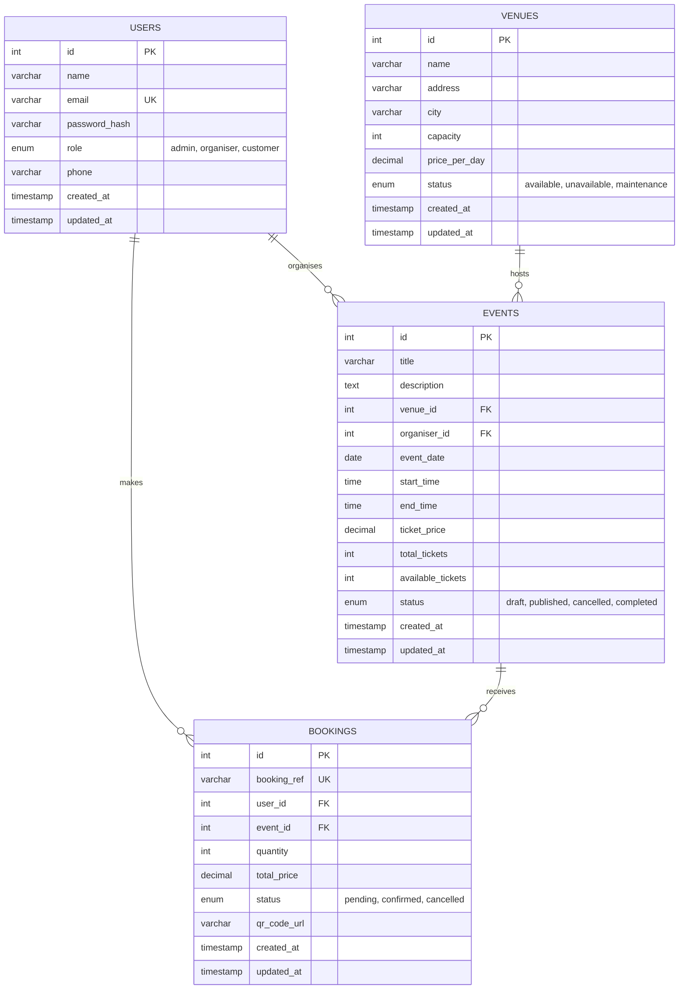

# Member 2 – Report Sections

## 2.0 Database Design

### 2.1 Overview
The system uses a MySQL database named `event_ticketing_db` (InnoDB, utf8mb4) with four related tables:
**Users**, **Venues**, **Events** and **Bookings**. Foreign keys enforce referential integrity, and
`ON DELETE RESTRICT` prevents deleting a user, venue or event that is still referenced, so booking
records are never lost by accident.

### 2.2 Entity Relationship Diagram (ERD)


*(Tip: paste the Mermaid code into https://mermaid.live to export a PNG for the Word report, or redraw it in
MySQL Workbench / draw.io.)*

**Relationships**

| Relationship | Type | Foreign key |
|---|---|---|
| Venue hosts Events | One-to-many | `events.venue_id → venues.id` |
| User (organiser) organises Events | One-to-many | `events.organiser_id → users.id` |
| User (customer) makes Bookings | One-to-many | `bookings.user_id → users.id` |
| Event receives Bookings | One-to-many | `bookings.event_id → events.id` |

Users and Events are therefore linked in a many-to-many way through Bookings.

### 2.3 Data Dictionary (summary)

| Table | Key columns | Notes |
|---|---|---|
| users | `id` PK, `email` UNIQUE, `role` ENUM | Passwords stored as bcrypt hashes, never plain text |
| venues | `id` PK, `capacity` > 0 | `status` supports Member 4's venue availability |
| events | `id` PK, `venue_id` FK, `organiser_id` FK | `available_tickets` ≤ `total_tickets` (CHECK) |
| bookings | `id` PK, `booking_ref` UNIQUE, `user_id` FK, `event_id` FK | `qr_code_url` stores the external QR Code API link (Member 5) |

### 2.4 SQL Scripts
- **DDL** – `database/schema.sql`: creates the database, drops old tables safely, and creates all four tables
  with primary keys, foreign keys, UNIQUE constraints, CHECK constraints and indexes.
- **DML** – `database/seed.sql`: inserts 6 users, 5 venues, 6 events and 8 bookings.
  Ticket counts in `events.available_tickets` already match the confirmed bookings.

*(Paste the full contents of both scripts here, or as appendices, and add phpMyAdmin screenshots of
the table structure, the Designer/relations view, and the populated tables.)*

### 2.5 Design Decisions
1. **Role in the Users table** – one table with a `role` ENUM keeps authentication simple and supports the three required roles (Administrator, Organiser/Staff, Customer).
2. **Hashed passwords** – bcrypt via PHP `password_hash()`.
3. **RESTRICT on deletes** – protects booking history; the API returns `409 Conflict` instead of a database error.
4. **Booking reference + QR URL** – gives each booking a unique, scannable ticket reference.
5. **Indexes** on `event_date`, `status`, `user_id`, `event_id` for faster search and filtering.

---

## Member 2 – Users API, Login and JWT (coding explanation for Parts 3 and 5)

**Authentication flow**
1. Client sends `POST /auth/login` with email and password.
2. Server finds the user, checks the password with `password_verify()`, and returns a signed **JWT (HS256)** containing `sub` (user id), `role`, `name`, `email`, `iat` and `exp` (2 hours).
3. Client sends `Authorization: Bearer <token>` on protected requests.
4. Middleware (`core/auth.php`) verifies signature and expiry (`require_auth()`), then checks the role (`require_role()`).

**Users API permissions**

| Action | Admin | Organiser | Customer |
|---|---|---|---|
| List users | ✔ | ✘ 403 | ✘ 403 |
| View user | any | own only | own only |
| Create user | ✔ | ✘ | ✘ (use `/auth/register`) |
| Update user | any (incl. role) | own (no role change) | own (no role change) |
| Delete user | ✔ (not self) | ✘ | ✘ |

**Validation and errors:** name 2–100 chars, valid email, password ≥ 8 with letters and numbers, role from the allowed list, optional phone format. Errors return a consistent JSON body with `422` (validation), `401` (no/invalid token or wrong login), `403` (wrong role), `404` (not found), `409` (duplicate email or user still referenced).

**Extra features:** pagination (`page`, `limit`), search by name/email, filter by role.

**Test cases for Postman (Member 4)**

| # | Request | Expected |
|---|---|---|
| 1 | POST /auth/login valid admin | 200 + token |
| 2 | POST /auth/login wrong password | 401 |
| 3 | POST /auth/login empty body fields | 422 |
| 4 | POST /auth/register new customer | 201 |
| 5 | POST /auth/register duplicate email | 409 |
| 6 | GET /users without token | 401 |
| 7 | GET /users as customer | 403 |
| 8 | GET /users?page=1&limit=3&search=a as admin | 200 + pagination |
| 9 | GET /users/999 as admin | 404 |
| 10 | PUT /users/4 as customer, body `{"role":"admin"}` | 403 |
| 11 | PUT /users/4 as customer, body `{"phone":"011-1234567"}` | 200 |
| 12 | DELETE /users/2 as admin (has events) | 409 |
| 13 | DELETE /users/{newly created} as admin | 200 |

---

## 7.0 Project Repository

### 7.1 Repository Information
- **Platform:** GitHub  
- **Repository URL:** `https://github.com/<username>/event-ticketing` *(replace after creating the repo)*  
- **Visibility:** Private, with the lecturer/tutor added as collaborator (or public if required).

### 7.2 Repository Structure
```
event-ticketing/
├── README.md
├── database/           schema.sql, seed.sql
├── api/                shared backend (PHP)
├── frontend/
│   ├── member1/  member2/  member3/  member4/  member5/    (each member's own frontend)
├── postman/            Event_Ticketing.postman_collection.json + screenshots
└── docs/               report, ERD image, contribution evidence
```

### 7.3 Setup Instructions
See `README.md`: install XAMPP → copy to `htdocs` → import `schema.sql` then `seed.sql` in phpMyAdmin → check `api/config/config.php` → open `http://localhost/event-ticketing/api/`.

### 7.4 Git Workflow
1. `main` is always working; no direct pushes to `main` after the first commit.
2. Each member works on a branch: `member1-event-browsing`, `member2-database-users`, etc.
3. Merge to `main` through a Pull Request reviewed by at least one other member.
4. Commit message style: `feat(users): add DELETE /users/{id}`, `fix(auth): return 401 for expired token`, `docs: add ERD`.

**Commands to set up (Member 2)**
```bash
cd C:\xampp\htdocs\event-ticketing
git init
git add .
git commit -m "chore: initial project structure, database scripts and users API"
git branch -M main
git remote add origin https://github.com/<username>/event-ticketing.git
git push -u origin main
```
Then invite the other members under **Settings → Collaborators**.

### 7.5 Contribution Record

| Member | Main contribution | Evidence |
|---|---|---|
| Member 1 | System overview, Event browsing frontend | commits / files |
| **Member 2** | Database, SQL scripts, Users API, JWT login, repository setup | `database/*.sql`, `api/routes/users.php`, `api/routes/auth.php`, `api/core/*`, commits |
| Member 3 | Events API, event management frontend, API documentation | commits / files |
| Member 4 | Venues API, venue frontend, Postman testing | commits / files |
| Member 5 | Bookings API, booking frontend, QR API, video | commits / files |

*(Add screenshots of the GitHub commit history and contributors graph.)*
